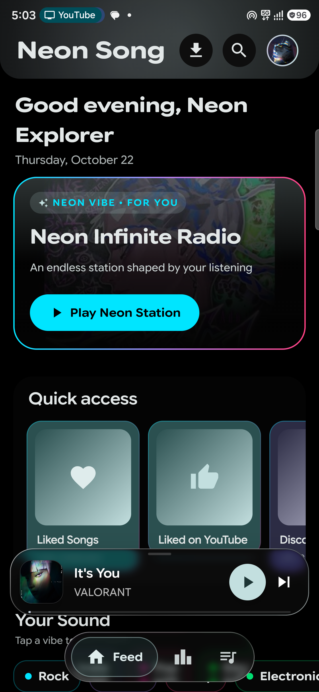
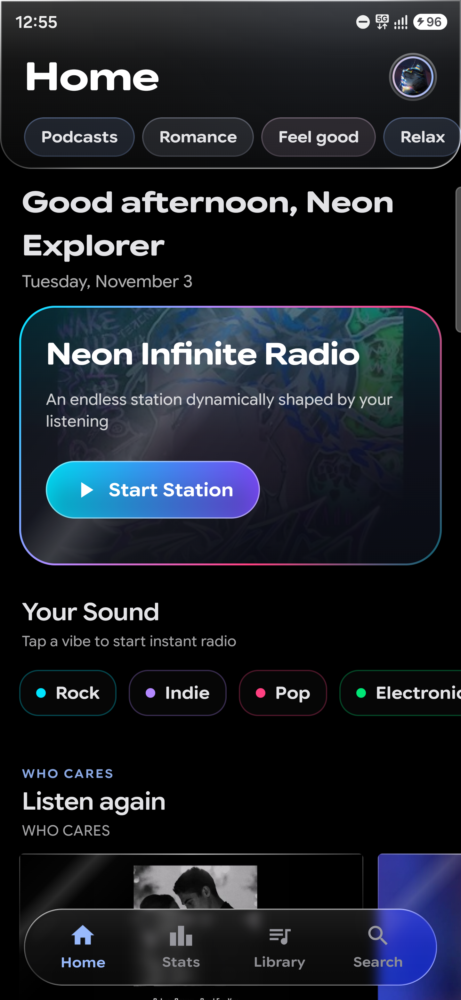
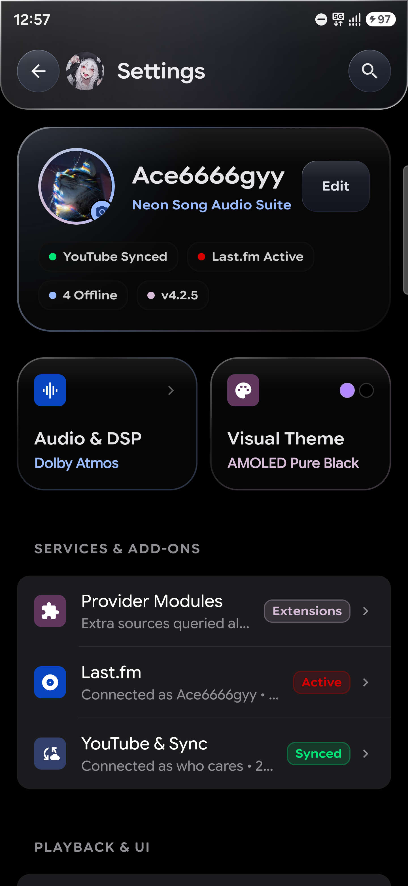
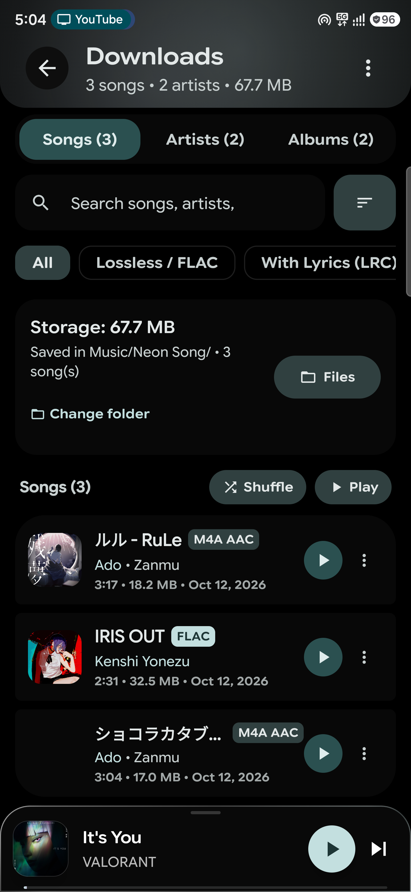
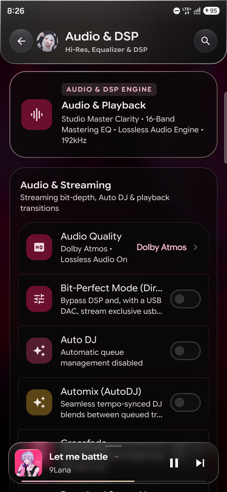
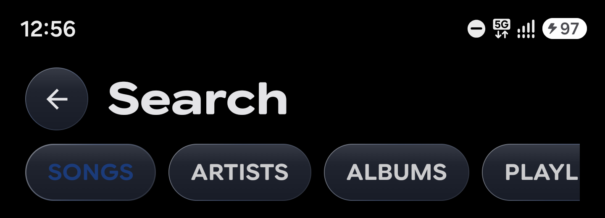
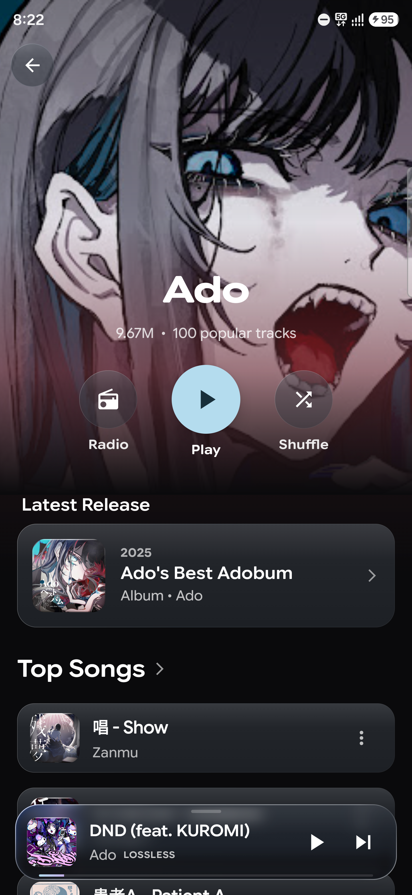
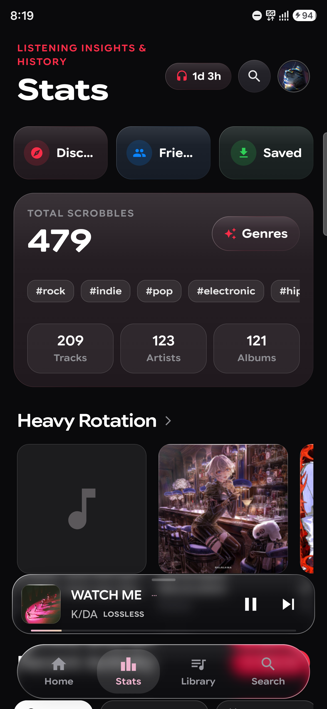

<div align="center">


# ⚡ Neon Song

### **Pure Sound. Zero Friction. Spatial Liquid Glass.**
**Next-Generation Audiophile Android Music Experience**  
*Engineered with 4D Liquid Glass UI, Song-Reactive Artwork Physics, a Polyglot Native DSP Core (C++20 / Rust / Kotlin), and Bit-Perfect Lossless Streaming.*

<br/>

[](https://github.com/ansh2222949/Neon-song/releases/latest)
[](https://github.com/ansh2222949/Neon-song/actions)
[](https://github.com/ansh2222949/Neon-song/releases)
[](https://kotlinlang.org/)
[](#%EF%B8%8F-2-audiophile-native-c20-dsp--audio-engine)
[](#-4-native-security-vault-rust-2021)
[](LICENSE)

<br/>

[**📥 Download APK**](#-download--installation) • [**🏛️ Architecture**](#%EF%B8%8F-codebase-architectural-blueprint) • [**🎛️ C++20 DSP Engine**](#%EF%B8%8F-2-audiophile-native-c20-dsp--audio-engine) • [**🔌 320kbps Gateway**](#-streaming-addons--custom-resolvers-neon-audio-gateway) • [**💻 Build from Source**](#-building-from-source)

---

> **Origin & License Notice:** **Neon Song** is an advanced audiophile derivative of *LastWave Native*, released under the **GNU General Public License v3.0 (GPL-3.0)**. See [`NOTICE.md`](NOTICE.md) and [`LICENSE`](LICENSE) for full licensing, third-party library notices, and upstream credits.

</div>

<br/>

## 📱 Visual Showcase

<div align="center">
<table>
  <tr>
    <td align="center" width="25%"><b>🌌 4D Ambient Player</b></td>
    <td align="center" width="25%"><b>🏠 Dynamic Home</b></td>
    <td align="center" width="25%"><b>💎 Liquid Glass Settings</b></td>
    <td align="center" width="25%"><b>📥 Offline Downloads</b></td>
  </tr>
  <tr>
    <td align="center"></td>
    <td align="center"></td>
    <td align="center"></td>
    <td align="center"></td>
  </tr>
  <tr>
    <td align="center"><b>🎛️ Audio Engine & DSP</b></td>
    <td align="center"><b>🔍 Real-Time Search</b></td>
    <td align="center"><b>🎤 Artist Showcase</b></td>
    <td align="center"><b>📊 Listening Insights</b></td>
  </tr>
  <tr>
    <td align="center"></td>
    <td align="center"></td>
    <td align="center"></td>
    <td align="center"></td>
  </tr>
</table>
</div>

---

## ✨ Why Neon Song? (At a Glance)

| 💎 **4D Liquid Glass UI** | 🎛️ **32-Bit Float C++20 DSP** | 📳 **4-Mode LRA Music Haptics** | 🔒 **Rust Security Vault** |
| :--- | :--- | :--- | :--- |
| Real-time optical refraction, specular bevel borders, song-reactive ambient backdrops, and 120Hz VSYNC-locked physics. | Lock-free SPSC ring buffers, 16-Band ISO Parametric EQ, AutoEQ headphone profiles, WSOLA tempo, & USB Exclusive DAC output. | Sub-bass (`<110 Hz`) and attack transient extraction driving hardware Linear Resonant Actuators (`PRIMITIVE_THUD` / `TICK`). | Hardware Keystore-bound chunk decryption, signature verification, and `zeroize` RAM scrubbing in Rust 2021. |

---

## 🏛️ Codebase Architectural Blueprint

Neon Song is engineered on **Clean Architecture** with strict **Unidirectional Data Flow (UDF)**, compile-time dependency injection via **Dagger Hilt**, and a polyglot native core bridging **Kotlin**, **C++20**, and **Rust**:

```text
┌────────────────────────────────────────────────────────────────────────────────────────┐
│                                 PRESENTATION LAYER                                     │
│  • Shell & Navigation: MainShell.kt, NavGraph.kt                                       │
│  • Visual Surfaces: FeedScreen.kt, PlaylistDetailScreen.kt, SettingsScreen.kt          │
│  • Design System: LiquidGlass.kt, ExpressiveGroup.kt, ExpressiveHeader.kt              │
│  • Player Presentation: PlayerHost.kt, CanvasArtworkPlayer.kt, WavySeekBar.kt          │
│  • Karaoke Lyrics: ModernLyricsView.kt, LyricsView.kt, LyricsOffsetDialog.kt           │
└───────────────────────────────────────────┬────────────────────────────────────────────┘
                                            │ StateFlow & UI Actions
┌───────────────────────────────────────────▼────────────────────────────────────────────┐
│                             FEATURE & VIEWMODEL LAYER                                  │
│  • ViewModels: PlayerViewModel, FeedViewModel, SettingsViewModel, PlaylistViewModel   │
│  • Domain & Controllers: AutoDJController, AutoEqController, SmartRouteProfileManager  │
│  • Repositories: FeedRepository, LyricsRepository, CanvasRepository, DiscoverRepository│
└───────────────────────────────────────────┬────────────────────────────────────────────┘
                                            │ Domain Invocations
┌───────────────────────────────────────────▼────────────────────────────────────────────┐
│                             PLAYBACK & AUDIO SUBSYSTEM                                 │
│  • Dual-Engine Player: MusicPlayer.kt (Primary + Standby ExoPlayer for Crossfade/DJ)   │
│  • Audio Sinks: NativeProcessingAudioSink.kt, NativePcmAudioProcessor.kt               │
│  • Routing & Intelligence: SmartRouteProfileManager.kt (Auto EQ/Clarity per route)     │
│  • Tactile Beats: MusicHapticsEngine.kt (4-Mode LRA Hardware Beat & Transient Engine)  │
│  • Diagnostics: SignalPath.kt (Real-time bit-depth, sample-rate & drift telemetry)     │
├───────────────────────────────────────────┬────────────────────────────────────────────┤
│         NATIVE C++20 DSP AUDIO ENGINE     │            NATIVE RUST VAULT               │
│         (neonsong_audio / JNI)            │          (neonsong-vault / JNI)            │
│  • Dual-Deck SPSC Lock-Free Ring Buffers  │  • App Signing & Integrity Verification    │
│  • 16-Band ISO Parametric EQ (±8 dB)      │  • Keystore-Bound Decryption Chunks        │
│  • Libsoxr HQ Sinc Resampler              │  • Native Runtime Tamper Protection        │
│  • WSOLA Pitch-Preserved Time Stretcher   │  • Zeroize Memory Wiping Protocols         │
│  • AutoDJ / AutoMix 2.0 Beatmatching      │                                            │
│  • 4th-Order Linkwitz-Riley Crossovers    │                                            │
│  • Soft-Knee True-Peak Limiter (-0.5 dBFS)│                                            │
│  • Oboe Low-Latency AAudio Stream         │                                            │
├───────────────────────────────────────────┴────────────────────────────────────────────┤
│                       AUDIO HARDWARE OUTPUT INTEGRATION                                │
│  • Android AudioTrack / AAudio • Spatializer HAL • USB Exclusive Isochronous DAC       │
└────────────────────────────────────────────────────────────────────────────────────────┘
```

---

## ⚡ In-Depth Technical Capabilities

### 💎 1. 4D Liquid Glass & Song-Reactive Visual Architecture
* **Live Dynamic Backdrop (`FluidArtworkBackground.kt`):** Observes active playback state and extracts dominant, vibrant, and deep swatches from cover artwork using asynchronous Palette quantization to render a multi-pass breathing ambient canvas.
* **Liquid Glass Refraction & Specular Chrome (`LiquidGlass.kt`):** Built on real-time `rememberLayerBackdrop` and `.liquidGlassSource(backdrop)` modifiers, combining directional specular borders, top optical bevel rims, and hardware-accelerated scrim layers for zero-allocation scrolling.
* **1:1 Interactive Sheet Morphing (`PlayerHost.kt`):** Custom `AppleSheetController` tracks finger velocity and displacement frame-by-frame, seamlessly morphing the MiniPlayer thumbnail into the full-screen 3D tilt-reactive album sleeve (or 16:9 HD video surface) with zero-overshoot spring physics.
* **VSYNC-Locked Frosted Waveform Seekbar (`WavySeekBar.kt`):** 3-layer counter-gradient harmonic wave seekbar with floating time-scrubber magnifier bubble and tactile detent ticks.

### 🎛️ 2. Audiophile Native C++20 DSP & Audio Engine
* **Dual-Deck Hybrid Playback (`MusicPlayer.kt`, `AudioEngine.cpp`):** Coordinates primary and standby Media3 ExoPlayer pipelines with custom `NativeProcessingAudioSink` processors and wait-free SPSC ring buffers (`LockFreeRingBuffer.h`). Supports **Hi-Res Lossless FLAC (up to 24-bit / 192 kHz)**, **Dolby Atmos (E-AC-3 JOC)** spatial streams, and zero-interruption quality hot-swapping.
* **16-Band ISO 2/3-Octave Parametric EQ (`ParametricEq.cpp`, `EqualizerPreferences.kt`):** Controls 16 standard ISO center frequencies (`20 Hz` to `20 kHz`) with biquad filter quality $Q = \sqrt{2}$ and smooth coefficient ramping.
* **Headphone Measurement Compensation (`AutoEqCatalog.kt`, `PeqFitter.kt`):** Bundled database of headphone frequency response targets (**Harman**, **Crinacle**, **Oratory1990**) with on-device parametric curve fitting.
* **Studio Master Clarity & Psychoacoustic Mastering (`DspProcessor.cpp`):**
  * **Studio Master Clarity:** Sub-bass lift, low-mid mud cut, vocal presence boost, and high-frequency air exciter across 4 output voicings (*Reference*, *Speaker*, *Headphone*, *USB DAC*).
  * **3D Spatial & Studio Immersion:** Mid/Side phase-pure vocal lock, pinna air cueing, and Haas soundstage expansion (with automatic bypass guard on native Dolby Atmos tracks).
  * **Analog & Crossfeed Processing:** Bauer stereophonic crossfeed, analog tube warmth, and mono bass summing (`<130 Hz`).
  * **Bluetooth AAC True-Peak Headroom:** Automatic `-1.2 dBFS` true-peak margin and `48 kHz` `libsoxr` HQ lock on Bluetooth A2DP / BLE Audio routes to eliminate inter-sample codec clipping.
* **WSOLA Time-Stretching & AutoMix 2.0 (`WsolaTimeStretcher.cpp`, `AutoMixEngine.cpp`):** Pitch-preserved tempo control (`0.25x` to `3.0x`) and beat-aligned DJ transitions with 4 crossover curves (*Equal Power*, *Smoothstep S-Curve*, *Club Bass Swap*, *Fast Drop*).
* **Bit-Perfect Mode & USB Exclusive DAC Output (`ExclusiveUsbOutput.kt`):** Bypasses all software DSP, EQ, and Android mixer resampling to deliver bit-exact PCM directly to USB Audio Class 1/2 DACs via `usbdevfs`, verified live by the **Signal Path Inspector** (`SignalPathDialog.kt`).

### 📳 3. Smart Route Profiles & Multi-Mode Music Haptics
* **Smart Route Profile Manager (`SmartRouteProfileManager.kt`):** Automatically detects active audio routes (*Bluetooth*, *Wired Headphones*, *USB DAC*, *Device Speaker*) and hot-swaps Clarity voicings and per-device saved EQ curves.
* **Tactile Music Haptics Engine (`MusicHapticsEngine.kt`):** Real-time C++ sub-bass (`<110 Hz`) and attack transient envelope extraction driving hardware Linear Resonant Actuator (LRA) primitives (`PRIMITIVE_THUD`, `PRIMITIVE_TICK`, `PRIMITIVE_LOW_TICK`) across **3 intensity levels** (*Low 0.62x*, *Normal 1.0x*, *Strong 1.35x*) and **4 Haptic Modes**:
  * 🥁 **Beats Only:** Punchy kicks & crisp snare hits.
  * 🎶 **All Music:** Beats, basslines & continuous synth groove swells.
  * 🎤 **Vocals & Melody:** Vocal articulation & melodic plucks.
  * 🔊 **Deep Bass:** Strictly `<110 Hz` 808s & sub-bass drops.

### 🔒 4. Native Security Vault (Rust 2021)
* **Native Rust Shared Library (`security/neonsong-vault` / `libneonsong_vault.so`):** Cross-compiled for `arm64-v8a`, `armeabi-v7a`, and `x86_64`. Provides hardware Keystore-bound chunk decryption, APK signature verification, runtime integrity checks, and automatic RAM scrubbing via `zeroize`.

### 🌐 5. Media Resolution, Sync & Offline Library
* **Synchronized Music Video & Animated Album Canvas (`CanvasArtworkPlayer.kt`):** One-tap switch between album sleeve and synced HD music video without interrupting the master audio clock, plus looping vertical Animated Album Canvas motion artwork.
* **24/7 YouTube Music & Last.fm Sync:** Two-way library & playlist mirroring, multi-channel account switching, real-time Last.fm scrobbling, and "Now Playing" love sync.
* **5-Way Playlist Import:** Import playlists via connected account, live search, public playlist URLs, external links, or `.csv` / `.m3u` files.
* **Synced Word-by-Word Karaoke Lyrics (`ModernLyricsView.kt`):** Multi-provider syllable and line-synced lyrics with 8 animation styles, live font scaling (`70%–150%`), and `±10,000 ms` sync offset control.
* **Offline Downloads & fMP4 Index Healing (`TrackDownloadManager.kt`):** Downloads with embedded cover art, `.lrc` companion files, custom `Artist/Album/` folder structures, and automatic `sidx`/`mfra` seek-index building for fragmented MP4 streams.

### 🖥️ 6. System & Desktop Integrations
* **Discord Rich Presence (`DiscordPresenceManager.kt`):** Broadcasts live track metadata, album artwork, and playback timestamps.
* **Android Auto & Google Cast (`CastPlayback.kt`):** Full car head-unit browsing and Chromecast streaming support.
* **Liquid Glass Home Screen Widgets (`NowPlayingWidgetReceiver.kt`):** Interactive home screen widgets with live artwork tinting.
* **Built-In Diagnostics & Crash Recorder (`CrashRecorder.kt`):** One-tap diagnostic bundle export with startup trail and persisted stack traces.

---

## 🛠️ Tech Stack & Specifications

| Layer | Technologies & Specifications |
| :--- | :--- |
| **Android SDK** | Compile SDK `37`, Target SDK `35`, Min SDK `29` (Android 10+) |
| **Languages** | Kotlin `2.x` (Compose Compiler `2.x`), C++20 (`Clang`), Rust `2021` (`Cargo NDK`) |
| **NDK & Alignment** | NDK `28.2.13676358` (**16 KB ELF Page-Size Aligned** for Android 15+) |
| **UI Architecture** | Jetpack Compose + Material 3 + Custom Liquid Glass Backdrop Modifiers |
| **Audio Subsystem** | AndroidX Media3 ExoPlayer + Bundled FFmpeg / Spatial MediaCodec + Google Oboe + `libsoxr` |
| **DI & Storage** | Dagger Hilt + Jetpack DataStore (Preferences) + Room SQLite Database |
| **Networking & Media** | OkHttp, Ktor, Kotlinx Serialization, Coil (with Custom StackBlur & Palette Quantization) |

---

## 🔌 Streaming Addons & Custom Resolvers (`neon-audio-gateway`)

Neon Song includes a modular streaming resolver engine with first-class support for **[`neon-audio-gateway`](https://github.com/ansh2222949/neon-audio-gateway)** (Direct 320kbps AAC CDN & Synced Lyrics).

1. **Deploy or Run the Gateway:** Deploy your instance of `neon-audio-gateway` on Cloudflare Workers / Vercel Edge, or run it locally (`http://<laptop-ip>:8787`).
2. **Open Neon Song Settings:** Navigate to **Settings → Modules & Addons** on your Android device.
3. **Add Custom Addon URL:** Paste your gateway manifest URL under **Custom Addon URL**:
   ```text
   https://neon-audio-gateway.<your-subdomain>.workers.dev/manifest.json
   ```
4. **Save & Stream:** Tap **Save / Connect** to verify `/manifest.json` and unlock instant 320kbps direct streaming.

---

## 📥 Download & Installation

### Latest Official Release (`v4.2.5`)

| Package Variant | Target OS | Supported Architectures | Size | Direct Download |
| :--- | :--- | :--- | :--- | :--- |
| **Universal Release APK** *(Recommended)* | Android 10+ (API 29–35) | `arm64-v8a`, `armeabi-v7a`, `x86_64` | **36.3 MB** | [**⚡ Download NeonSong.apk**](https://github.com/ansh2222949/Neon-song/releases/latest/download/NeonSong.apk) |
| **Optimized Release APK** | Android 10+ (API 29–35) | `arm64-v8a`, `armeabi-v7a` | **36.3 MB** | [**📦 Download Release APK**](https://github.com/ansh2222949/Neon-song/releases/download/v4.2.5/Neon.Song-v4.2.5-release.apk) |
| **Legacy Android 7 APK** | Android 7.0 – 9.0 (API 24–28) | Multi-arch | **30.0 MB** | [**📱 Download Legacy APK**](https://github.com/ansh2222949/Neon-song/releases/download/v4.2.5/Neon.Song-v4.2.5-android7.apk) |
| **SHA-256 Checksums** | All Builds | Verification Text | < 1 KB | [**🔒 View SHA256SUMS.txt**](https://github.com/ansh2222949/Neon-song/releases/download/v4.2.5/SHA256SUMS.txt) |

> 💡 **Installation Note:** When prompted on Android, enable *"Install unknown apps"* for your browser or file manager, then tap **Install**. All APKs are built reproducibly via GitHub Actions.

---

## 📂 Repository Directory Layout

```text
Neon-song/
├── app/                                    # Main Android application module
│   ├── build.gradle.kts                    # AGP build script (CompileSdk 37, TargetSdk 35, MinSdk 29)
│   ├── src/main/
│   │   ├── AndroidManifest.xml             # Permissions, activities & MediaSession declarations
│   │   ├── cpp/                            # Native C++20 DSP audio engine (16 KB page-aligned)
│   │   │   ├── AudioEngine.cpp/.h          # Core Oboe AAudio stream & dual-deck mixer
│   │   │   ├── AutoMixEngine.cpp/.h        # Real-time dual-deck beatmatching & mixing engine
│   │   │   ├── BpmPhaseDetector.cpp/.h     # Real-time Butterworth tempo & phase detector
│   │   │   ├── DspProcessor.cpp/.h         # 16-band EQ, Clarity, 3D Spatial, Limiter & Haptics
│   │   │   ├── EchoTailProcessor.h         # Tempo-synced DJ echo tail & freeze processor
│   │   │   ├── LinkwitzRileyFilter.h       # 4th-order (24 dB/oct) crossover filters
│   │   │   ├── LockFreeRingBuffer.h        # Wait-free SPSC circular audio ring buffers
│   │   │   ├── ParametricEq.cpp/.h         # High-precision biquad parametric filter bank
│   │   │   ├── WsolaTimeStretcher.cpp/.h   # WSOLA pitch-preserved time-stretcher
│   │   │   └── CMakeLists.txt              # CMake script linking Oboe & libsoxr
│   │   ├── jniLibs/                        # Precompiled native Rust vault binaries
│   │   ├── java/com/neonsong/app/
│   │   │   ├── composition/                # Hilt DI composition root & native bridges
│   │   │   ├── core/                       # Clean architecture contracts & Liquid Glass modifiers
│   │   │   ├── data/                       # Repositories, Room DB, DataStore & stream resolvers
│   │   │   ├── diagnostics/                # Crash recorder & startup trail telemetry
│   │   │   ├── features/                   # Modular features (player, lyrics, queue, settings)
│   │   │   ├── playback/                   # MusicPlayer, Haptics, SmartRoute & USB Exclusive DAC
│   │   │   ├── presence/                   # Discord Rich Presence transport
│   │   │   ├── ui/                         # Jetpack Compose screens (Feed, Player, Settings)
│   │   │   └── widget/                     # Liquid Glass home screen widgets
│   │   └── res/                            # Drawables, layouts & localized strings
│   └── src/test/                           # Unit tests & playback verification
├── audio/                                  # Modular native USB Audio Class 1/2 drivers
├── security/                               # Rust 2021 security crate (neonsong-vault)
├── docs/                                   # Architecture blueprints & showcase screenshots
├── NOTICE.md                               # Attribution & third-party open-source notices
├── SECURITY.md                             # Vulnerability reporting policy
└── README.md                               # Master documentation
```

---

## 💻 Building from Source

### Prerequisites
* **Android Studio:** Ladybug (`2024.2.1+`) or newer.
* **JDK:** JDK `17` or JDK `21`.
* **Android SDK & NDK:** SDK Platform `35`/`37`, NDK `28.2.13676358`, CMake `3.22.1+`.
* **Rust Toolchain** *(optional, only if recompiling `neonsong-vault`)*:
  ```bash
  curl --proto '=https' --tlsv1.2 -sSf https://sh.rustup.rs | sh
  rustup target add aarch64-linux-android armv7-linux-androideabi x86_64-linux-android
  ```

### Build & Install Commands
```bash
# 1. Clone the repository
git clone https://github.com/ansh2222949/Neon-song.git
cd Neon-song

# 2. Assemble the Debug APK
./gradlew :app:assembleDebug

# 3. Install directly to a connected Android device
./gradlew :app:installDebug
```

---

## 📄 License & Legal Disclaimer

* **License:** **Neon Song** is distributed under the **GNU General Public License v3.0 (GPL-3.0)**. See [`LICENSE`](LICENSE) and [`NOTICE.md`](NOTICE.md) for full terms and upstream attributions.
* **Disclaimer:** Neon Song is an independent open-source audio player and client developed for personal and educational use. It does not host, archive, or distribute any copyrighted audio or video files on its own servers. All third-party trademarks (including *YouTube Music*, *Last.fm*, *Dolby Atmos*, and *Android*) are the property of their respective owners.

<div align="center">
<br/>

**Neon Song** — *Crafted with architectural precision by **Ansh Shrivastava** for audiophiles, design purists, and music enthusiasts.*

</div>
