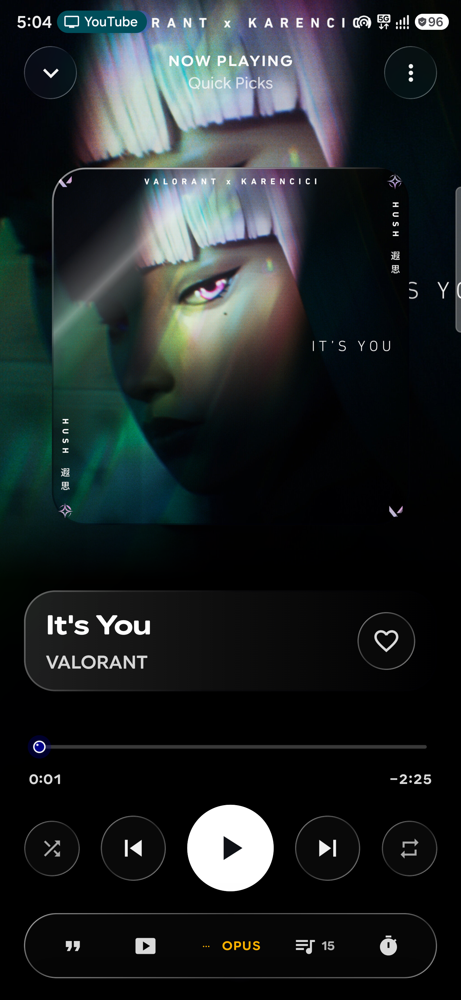

# Neon Song ⚡🎵

<p align="center">
  
</p>

<p align="center">
  <b>Next-Gen Native Android Music Player</b><br>
  <i>Powered by 4D Liquid Glass UI, YouTube Music Stream Engine, and Audiophile Soundstage.</i>
</p>

<p align="center">
  
  
  
  
  
</p>

---

## 📱 Visual Showcase

<div align="center">

| 🌌 4D Ambient Player | 🏠 Home & Discovery | 💎 Liquid Glass Settings |
|:---:|:---:|:---:|
|  |  |  |

<br>

| 🎨 Hero Artwork Player | 📥 Offline Library & Downloads |
|:---:|:---:|
|  |  |

</div>

---

## ✨ Features

### 🎧 4D Audiophile Player Experience
- **Depth-Elevated Artwork Card**: 3D perspective artwork cards with specular border highlights and soft shadow depth.
- **Dynamic Breathing Backdrops**: Ambient gradient mesh that subtly breathes and reacts with the track's dominant palette.
- **Ultra-Slim Wave Seekbar**: Ultra-sleek `3.0dp` waveform track with a floating jewel-bead scrubber and specular neon halo.
- **Real-Time Stream Format Detection**: Dynamic badge identifying active playback stream (`OPUS`, `HI-RES`, `LOSSLESS`, `ATMOS`).
- **Enhanced Motion Glow**: Atmospheric multi-layer breathing glow beneath the playback dock.

### ⚡ Liquid Glass UI & Theming
- **Translucent Glass Tiles**: Frosted acrylic materials (`18dp` backdrop blur, subtle inner stroke, elevated press feedback).
- **Material 3 Expressive**: Dynamic color theming dynamically extracted from track artwork.
- **Haptic Feedback**: Multi-tier tactile vibrations for button presses, scrubbing, and gesture triggers.

### 🌐 YouTube Music Streaming & Sync
- **Ad-Free Music Streaming**: High-efficiency Opus / AAC streaming directly from YouTube Music.
- **Background & Lockscreen Playback**: System notification controls with synced progress and media session integration.
- **In-App Music Video Mode**: One-tap toggle to watch the official YouTube music video synchronized with current audio.

### 🎤 Real-Time Synced Karaoke Lyrics
- Millisecond-accurate word & line synchronized lyrics.
- Smooth spring-based auto-scrolling with tactile swipe seeking.

### 💾 Offline Downloads Vault
- One-tap download to local storage.
- Embedded high-res artwork, artist metadata, and clean folder structures.

---

## 🛠️ Architecture & Tech Stack

| Component | Technology |
|---|---|
| **Architecture** | Clean Architecture + MVVM + Unidirectional Data Flow |
| **Language & UI** | 100% Kotlin + Jetpack Compose (Material 3 Expressive) |
| **Audio Engine** | AndroidX Media3 ExoPlayer with native audio pipelines |
| **Local Database** | Room Database + Jetpack DataStore |
| **Dependency Injection** | Dagger Hilt |
| **Asynchronous Engine** | Kotlin Coroutines & Reactive Flows |
| **Network & Parsing** | Ktor, OkHttp, Retrofit |

---

## 🚀 Getting Started

### Prerequisites
- Android Studio Ladybug / Meerkat (or newer)
- JDK 17 or higher
- Android SDK 35 (Target API 35, Min API 26)

### Build & Run
```bash
# Clone the repository
git clone https://github.com/ansh2222949/Neon-song.git
cd Neon-song

# Assemble debug APK
./gradlew assembleDebug

# Install directly to a connected device
./gradlew installDebug
```

---

## 📄 License
This project is licensed under the **GNU General Public License v3.0 (GPL-3.0)**. See the [LICENSE](LICENSE) file for details.
